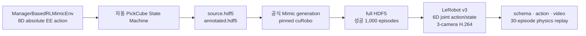

# SO-101 SkillGen 데이터 생성

Isaac Lab 2.3.2의 공식 Mimic/SkillGen 흐름을 SO-101 `Cube1 → Bowl` 태스크에 적용해
SmolVLA 입력 계약의 LeRobot v3 데이터를 만드는 경로다. VLA 학습·추론과 실기기 배포는 이
문서 범위에 포함하지 않는다.

참고: [Isaac Lab SkillGen 공식 문서](https://isaac-sim.github.io/IsaacLab/main/source/overview/imitation-learning/skillgen.html)



## 핵심 설계

- 전용 환경 ID는 `SimToReal-SO101-PickCube-SkillGen-{DRBase,DR}-v0`이고 일반 VLA 환경과
  분리한다. 환경 class는 `ManagerBasedRLMimicEnv`를 상속한다.
- source action은 robot-base frame의 absolute
  `[x,y,z,qw,qx,qy,qz,gripper_binary]` 8D다. DLS IK가 SO-101 5 arm joints를 구동한다.
- `grasp_cube`와 `place_cube` boundary는 State Machine phase와 실제 grasp/place 상태에서
  자동 기록한다. `annotate_demos.py --auto`는 쓰지 않는다.
- Skill transition은 Isaac Lab 2.3.2가 검증한 cuRobo commit
  `ebb71702f3f70e767f40fd8e050674af0288abe8`로 계획한다. 기존 프로젝트의 cuRobo v0.8
  runtime과 image/Python path를 공유하지 않는다.
- SO-101은 arm 5-DOF이므로 재배치된 full orientation pose를 항상 만족할 수 없다. cuRobo는
  공식 `PoseCostMetric`의 position-only partial pose로 collision-free transition을 만들고,
  원본 8D quaternion target은 Mimic 구간과 DLS가 계속 추종한다.
- canonical 변환은 raw 8D action이 아니라 환경에 실제 적용된 `joint_data/target`과
  `joint_data/state`를 사용한다. arm은 degree, gripper는 affine `[0,100]`의 6D다.
- DLS target은 physics-step 기준 5 rad/s slew와 articulation soft joint limit을 적용한다.
  그리퍼는 2.5 rad/s다. 최종 action에 velocity violation이 하나라도 있으면 실패다.

## Runtime 빌드와 확인

```bash
docker compose --env-file .env -f docker/docker-compose.yaml build skillgen

docker compose --env-file .env -f docker/docker-compose.yaml run --rm skillgen \
  python -c 'import curobo, isaaclab_mimic; print("SkillGen runtime OK")'
```

이미지 `so101-skillgen:isaaclab-2.3.2-curobo-ebb7170`은 기존 `curobo-datagen`/v0.8
이미지와 별도다. 이미지 label의 Isaac Sim 5.1.0, Isaac Lab 2.3.2, cuRobo commit을 실행
manifest에 기록한다.

## 1. 자동 source와 annotation

```bash
docker compose --env-file .env -f docker/docker-compose.yaml run --rm skillgen \
  python /workspace/scripts/datagen/record_skillgen_source.py \
  --headless --enable_cameras \
  --task SimToReal-SO101-PickCube-SkillGen-DRBase-v0 \
  --num-demos 10 --seed 55000 \
  --source-file /workspace/datasets/skillgen/source/source.hdf5 \
  --annotated-file /workspace/datasets/skillgen/annotated/annotated.hdf5 \
  --summary-file /workspace/outputs/skillgen/reports/source_generation.json
```

검증:

```bash
docker compose --env-file .env -f docker/docker-compose.yaml run --rm skillgen \
  python /workspace/scripts/contract/validate_skillgen_env_contract.py \
  --headless --task SimToReal-SO101-PickCube-SkillGen-DRBase-v0 \
  --report-file /workspace/outputs/skillgen/reports/env_contract.json --steps 30

.venv/bin/python scripts/contract/validate_skillgen_source_annotation.py \
  --source-file datasets/skillgen/source/source.hdf5 \
  --annotated-file datasets/skillgen/annotated/annotated.hdf5 \
  --report-file /DISK1/so101-sim2real/skillgen/reports/source_annotation_validation.json \
  --expected-episodes 10

SKILLGEN_DATA_ROOT=/DISK1/so101-sim2real/skillgen \
docker compose --env-file .env -f docker/docker-compose.yaml run --rm skillgen \
  python /workspace/scripts/datagen/replay_skillgen_source.py \
  --headless --task SimToReal-SO101-PickCube-SkillGen-DRBase-v0 \
  --dataset-file /workspace/datasets/skillgen/source/source.hdf5 \
  --summary-file /workspace/outputs/skillgen/reports/source_replay.json \
  --min-success-rate 0.9
```

## 2. Smoke와 full generation

성공 10개 smoke의 전체 success rate가 40% 이상인 것을 확인한 뒤에만 full generation을
시작한다. full run은 25-success shard로 저장하므로 중단 후 `--resume`이 가능하다.

```bash
# smoke
docker compose --env-file .env -f docker/docker-compose.yaml run --rm skillgen \
  python /workspace/scripts/datagen/generate_skillgen.py \
  --headless --task SimToReal-SO101-PickCube-SkillGen-DRBase-v0 \
  --input-file /workspace/datasets/skillgen/annotated/annotated.hdf5 \
  --output-file /workspace/datasets/skillgen/generated/smoke.hdf5 \
  --summary-file /workspace/outputs/skillgen/reports/smoke_generation.json \
  --generation-num-trials 10 --seed 56000

.venv/bin/python scripts/contract/validate_skillgen_generated_hdf5.py \
  --input-file datasets/skillgen/generated/smoke.hdf5 \
  --report-file /DISK1/so101-sim2real/skillgen/reports/smoke_hdf5_validation.json \
  --expected-episodes 10

.venv/bin/python scripts/contract/validate_skillgen_action_quality.py \
  --input-hdf5 datasets/skillgen/generated/smoke.hdf5 \
  --report-file /DISK1/so101-sim2real/skillgen/reports/smoke_action_quality.json \
  --expected-episodes 10

# full: 대용량 디스크에 1,000 successful episodes 생성
.venv/bin/python scripts/datagen/run_skillgen_full.py \
  --data-root /DISK1/so101-sim2real/skillgen \
  --total-successes 1000 --shard-size 25 --base-seed 58000 --resume

# VRAM 측정 후 두 번째 1-env worker를 쓸 때의 비중복 범위 예시
.venv/bin/python scripts/datagen/run_skillgen_full.py \
  --data-root /DISK1/so101-sim2real/skillgen \
  --total-successes 1000 --shard-size 25 --base-seed 58000 \
  --start-shard 20 --stop-shard 40 --resume

# 검증된 shard 병합
.venv/bin/python scripts/datagen/merge_skillgen_shards.py \
  --input-dir /DISK1/so101-sim2real/skillgen/full/shards \
  --output-file /DISK1/so101-sim2real/skillgen/full/full.hdf5 \
  --report-file /DISK1/so101-sim2real/skillgen/reports/full_merge.json \
  --expected-episodes 1000 --resume

.venv/bin/python scripts/contract/validate_skillgen_generated_hdf5.py \
  --input-file /DISK1/so101-sim2real/skillgen/full/full.hdf5 \
  --report-file /DISK1/so101-sim2real/skillgen/reports/full_hdf5_validation.json \
  --expected-episodes 1000 --require-images
```

`SKILLGEN_DATA_ROOT`를 compose에 주입하면 컨테이너의 `/workspace/skillgen-data`가 해당
대용량 경로를 가리킨다. 미완성 shard는 `full/incomplete/`로 이동하며 검증된 완료 shard는
덮어쓰지 않는다.

## 3. Canonical LeRobot v3 변환과 QA

```bash
.venv/bin/python scripts/convert/skillgen_hdf5_to_lerobot_v3.py \
  --input-file /DISK1/so101-sim2real/skillgen/full/full.hdf5 \
  --output-dir /DISK1/so101-sim2real/skillgen/lerobot \
  --report-file /DISK1/so101-sim2real/skillgen/reports/conversion.json \
  --expected-episodes 1000 --video-codec h264_nvenc \
  --video-preset p4 --ffmpeg-exe /usr/bin/ffmpeg

.venv/bin/python scripts/contract/validate_lerobot_schema.py \
  /DISK1/so101-sim2real/skillgen/lerobot --require-all-cameras \
  --report-file /DISK1/so101-sim2real/skillgen/reports/schema_validation.json

.venv/bin/python scripts/contract/validate_skillgen_action_quality.py \
  --lerobot-root /DISK1/so101-sim2real/skillgen/lerobot \
  --report-file /DISK1/so101-sim2real/skillgen/reports/action_quality.json \
  --expected-episodes 1000

.venv/bin/python scripts/contract/validate_lerobot_videos.py \
  /DISK1/so101-sim2real/skillgen/lerobot \
  --report-file /DISK1/so101-sim2real/skillgen/reports/video_validation.json \
  --full-decode
```

최종 feature는 다음과 같다.

| Feature | 계약 |
|---|---|
| `action` | `float32[6]`, applied joint target |
| `observation.state` | `float32[6]`, actual joint state |
| `observation.images.{top,wrist,front}` | H.264, 480×640 RGB, 30 FPS |

SmolVLA의 `camera1/2/3` rename은 데이터 생성물이 아니라 학습 profile에서 수행한다.

## 4. 최종 physics replay

최종 parquet의 6D action을 다시 sim radians로 바꿔 HDF5의 동일 초기 scene state에서 직접
적용한다. source 8D action을 재사용하지 않는다. 중앙, DR 경계, Bowl 근접, 고정 selection
seed 표본으로 최소 30개를 뽑는다.

```bash
SKILLGEN_DATA_ROOT=/DISK1/so101-sim2real/skillgen \
docker compose --env-file .env -f docker/docker-compose.yaml run --rm skillgen \
  python /workspace/scripts/contract/replay_skillgen_lerobot_audit.py \
  --headless --enable_cameras \
  --generated-hdf5 /workspace/skillgen-data/full/full.hdf5 \
  --lerobot-root /workspace/skillgen-data/lerobot \
  --summary-file /workspace/skillgen-data/reports/replay_audit.json \
  --video-dir /workspace/skillgen-data/replay/videos \
  --sample-count 30 --selection-seed 93017 --min-success-rate 0.9
```

완료 판정은 1,000 successful episodes, generation rate ≥40%, schema/video 오류 0,
action joint/velocity violation 0, 30-episode replay ≥90%, manifest/checksum이 모두 존재할 때만
한다.

## 5. 최종 manifest와 checksum

대표 실패 영상은 `generate_skillgen.py --keep-failed --record-images`가 만든 별도
`*_failed.hdf5`에서 인코딩한다. 성공-only canonical HDF5에는 실패 episode를 섞지 않는다.
모든 검증 report와 영상이 준비된 뒤 다음 명령이 실제 artifact를 다시 판정해 Gate A–J,
`manifest.json`, `SHA256SUMS`, `RESULT.md`를 만든다.

```bash
.venv/bin/python scripts/contract/finalize_skillgen_artifacts.py \
  --data-root /DISK1/so101-sim2real/skillgen \
  --failure-video /DISK1/so101-sim2real/skillgen/final_evidence/representative_failure.mp4
```
